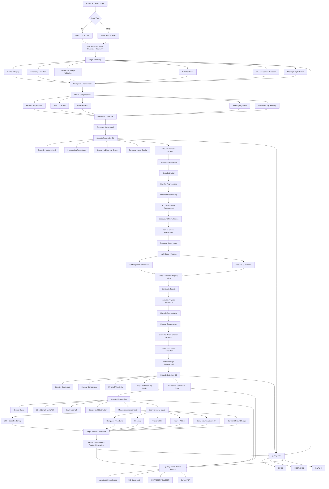
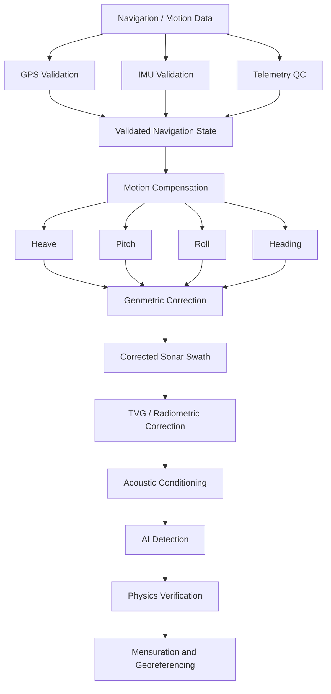
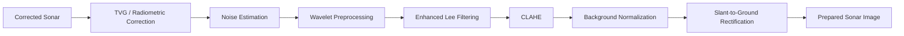
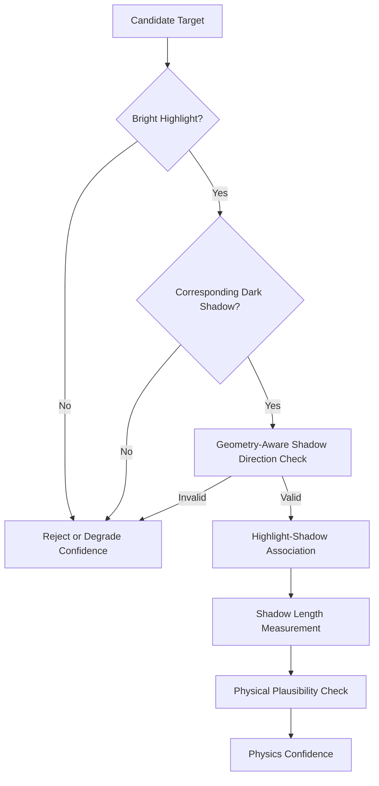
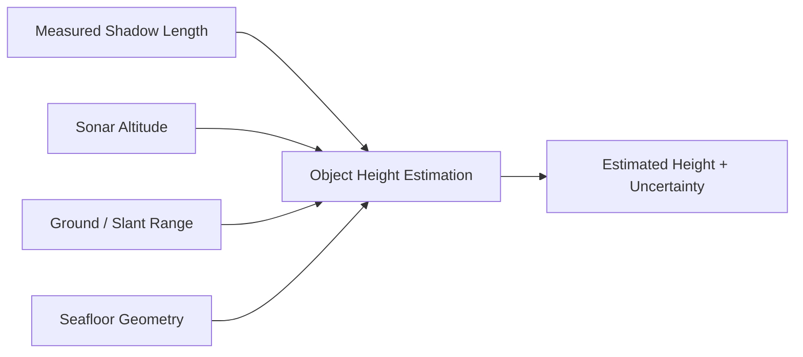
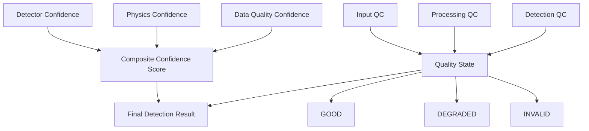

# Marine Debris Detection System Architecture

## 1. System Purpose

The system processes side-scan sonar data to detect marine debris, ghost nets, shipwrecks, subsea infrastructure, and other acoustic anomalies. It combines acoustic image processing, YOLO-based object detection, acoustic shadow verification, sonar geometry, navigation data, and GIS reporting.

The architecture is designed to address:

- Acoustic speckle noise and low contrast
- Variable sonar resolution and range distortion
- Acoustic highlight and shadow interpretation
- Vehicle motion from heave, pitch, and roll
- Missing or degraded navigation and scan lines
- Accurate target measurement and georeferencing

## 2. High-Level System Architecture

```mermaid
flowchart LR
    A[Raw XTF / Sonar Image] --> B[Data Ingestion]
    B --> C[Sonar Packet and Image Extraction]
    C --> D[Telemetry and Input QC]
    D --> E[Motion and Geometric Correction]
    E --> F[TVG / Radiometric Correction]
    F --> G[Acoustic Conditioning]
    G --> H[AI Object Detection]
    H --> I[Acoustic Physics Verification]
    I --> J[Measurement and Height Estimation]
    J --> K[Georeferencing]
    K --> L[Quality-Aware Reporting]
    L --> M[GIS Dashboard and Survey Reports]
```



### Main stages

1. **Data ingestion** accepts raw XTF files or sonar image inputs.
2. **Sonar extraction** decodes channels, pings, timestamps, and sensor telemetry.
3. **Telemetry and input QC** validates packets, timestamps, channels, GPS, attitude, and sensor values.
4. **Motion and geometric correction** uses navigation and attitude data to create a corrected sonar swath.
5. **TVG / radiometric correction** compensates for range-dependent acoustic intensity loss.
6. **Acoustic conditioning** reduces speckle and improves target-to-background contrast.
7. **AI object detection** identifies candidate targets at multiple scales.
8. **Acoustic physics verification** confirms highlight-shadow relationships.
9. **Measurement and height estimation** calculates ground range, dimensions, and estimated height.
10. **Georeferencing** converts sonar detections into WGS84 coordinates.
11. **Quality-aware reporting** publishes detections, confidence, uncertainty, and processing quality.

## 3. Detailed Processing Architecture



## 4. Navigation and Motion Data Flow

Navigation data must not terminate at validation. It must directly control swath reconstruction and later georeferencing.



## 5. Acoustic Conditioning Flow

The initial conditioning path uses Enhanced Lee filtering. Wiener and Frost filtering can be evaluated later as alternative methods, but they are not chained automatically with Lee filtering.



## 6. Acoustic Physics Verification

The verifier checks more than detector confidence. It determines whether the candidate has the expected acoustic structure of a physical object.



Shadow direction is determined from sonar geometry, port/starboard orientation, nadir position, vehicle heading, and sensor mounting configuration. It is not assumed to always point in a fixed image direction.

## 7. Height Estimation Inputs

Shadow length alone is insufficient for reliable target height estimation. The calculation combines the measured shadow with sonar geometry and altitude information.



The geometric model is:

$$
H_t = \frac{L_g H_a}{R_g + L_g}
$$

where $H_t$ is target height, $L_g$ is ground-range shadow length, $H_a$ is sonar altitude, and $R_g$ is ground range to the target.

## 8. Composite Confidence and Quality State

The final result combines three evidence groups:



Example result:

```json
{
  "object": "ghost_net",
  "confidence": 0.91,
  "latitude": 11.0123,
  "longitude": 76.9558,
  "quality": "GOOD"
}
```

A degraded result should preserve the detection while explaining its limitations:

```json
{
  "object": "ghost_net",
  "confidence": 0.67,
  "quality": "DEGRADED",
  "quality_reasons": [
    "high_roll",
    "missing_ping_interpolation",
    "estimated_altitude"
  ]
}
```

## 9. Georeferencing Inputs

The sonar pixel-to-coordinate transformation uses the following inputs:

- GPS or dead-reckoned platform position
- Navigation timestamp matched to the detection ping
- Vehicle and towfish heading
- Pitch and roll
- Heave or sonar altitude
- Sonar mounting offsets and orientation
- Port/starboard channel geometry
- Slant-to-ground corrected range

The output includes WGS84 coordinates and an uncertainty estimate rather than coordinates alone.

## 10. Recommended PPT Presentation

### Slide 1: High-Level Architecture

Use the system architecture diagram from Section 2. Explain the pipeline in one sentence:

> Raw sonar data is decoded, motion-corrected, acoustically enhanced, analyzed by AI, verified using acoustic physics, georeferenced, and delivered through GIS reports.

### Slide 2: Detailed Technical Flow

Use the detailed processing diagram from Section 3. Emphasize that navigation and quality information flow into corrected sonar, detection, mensuration, georeferencing, and final reporting.

### Slide 3: Key Innovation

Show the acoustic physics verification diagram from Section 6. Emphasize that a candidate is not accepted using AI confidence alone; its highlight, shadow, direction, and physical plausibility are also evaluated.

### Slide 4: Output

Show the quality-aware result containing:

- Detected object class
- Composite confidence
- Object dimensions and estimated height
- WGS84 coordinates
- Quality state and reasons
- Annotated sonar image and GIS report
