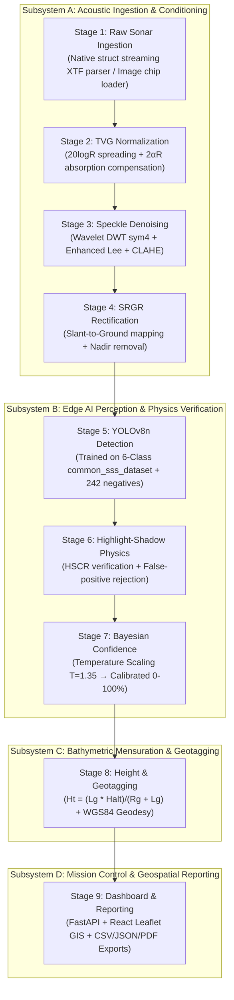

# Phase 2 Master Implementation Plan: Complete End-to-End SSS Pipeline

This plan outlines the complete, phased development sequence to transform our prototype into an industrial-grade, edge-deployable Side-Scan Sonar (SSS) Marine Debris and Ghost Net detection system. It formalizes the 9-stage processing pipeline into 4 cleanly decoupled subsystems with clear execution milestones, architectural contracts, and validation criteria.

---

## Architecture: The 9-Stage Pipeline Across 4 Subsystems



---

## User Review Required

> [!IMPORTANT]
> **Subsystem Coupling & Ordering:**
> * **TVG before Denoising (Stage 2 $\to$ Stage 3):** Normalizing acoustic range decay *before* adaptive speckle filtering ensures stationary noise variance across the swath.
> * **SRGR before Detection (Stage 4 $\to$ Stage 5):** Rectifying slant-range images into metric ground-range removes nadir compression so that objects retain isotropic geometry regardless of cross-track distance.

> [!WARNING]
> **GPU Training Resource:**
> Retraining YOLOv8n on the 1,759-image `common_sss_dataset` (including negative backgrounds) will run on the local NVIDIA RTX 3050 Laptop GPU. We propose 35 epochs (~12–15 minutes runtime).

---

## Open Questions

1. **SRGR Mode for Image Chips vs. Continuous Swaths:**
   * Field datasets like KLSG contain pre-cropped image chips, whereas raw XTF files contain continuous full-swath waterfalls.
   * *Proposed Approach:* Implement dual-mode input handling: continuous full-swath waterfalls undergo automatic TVG + SRGR; pre-cropped image chips pass directly through TVG + speckle filtering with a flag indicating ground-range status. Does this meet your workflow needs?
2. **Model Training Epochs on Unified 6-Class Dataset:**
   * Shall we train YOLOv8n for **35 epochs** (balanced fast convergence, ~12 min) or **50 epochs** (maximum mAP convergence on hard negatives, ~18 min)?
3. **PDF Generation Dependency:**
   * For the Stage 9 PDF survey export, we propose using `reportlab` (standard pure-Python PDF generator, zero external browser binaries, runs natively on Jetson/embedded Linux). Does this suit your deployment environment?
4. **Export Formats for Edge Runtime:**
   * Besides native PyTorch (`best.pt`), should we automatically export the model to **ONNX** (`best.onnx`) and generate an FP16 TensorRT export script for Jetson devices?

---

## Proposed Phased Implementation

### Phase 2.1: Acoustic Ingestion & Conditioning Subsystem (Stages 1–4)
* **Objective:** Implement full TVG and SRGR math into the pipeline, chaining them with Wavelet/Lee filtering.

#### [MODIFY] [speckle_filter.py](file:///c:/Users/saran/Downloads/SODD/pipeline/modules/filtering/speckle_filter.py)
* Add `apply_tvg_normalization(image, altitude_m=12.0, max_range_m=75.0, alpha_db_per_m=0.15)`:
  * Computes range-dependent gain $G(r) = 20 \log_{10}(r + 1) + 2 \alpha r$.
  * Equalizes cross-track mean intensity while preserving local speckle contrast.
* Add `apply_srgr_rectification(image, altitude_m=12.0, max_range_m=75.0)`:
  * Converts slant-range pixel columns to uniform ground-range columns $R_g = \sqrt{R_s^2 - H_{alt}^2}$.
  * Crops or interpolates the nadir blind zone (water column).
* Update `sss_denoise_pipeline()` to orchestrate: `TVG -> Wavelet DWT -> Enhanced Lee -> CLAHE -> SRGR`.

---

### Phase 2.2: Edge AI Perception & Retraining (Stage 5)
* **Objective:** Retrain YOLOv8n on the master `common_sss_dataset` (1,759 images) across all 6 classes and hard negatives.

#### Phase 2.2.1: Natural-Seabed vs. Artificial-Anomaly Dataset Hardening
* **Objective:** Improve the model's ability to distinguish anthropogenic debris from natural seafloor topology before the next training run.
* Audit `seafloor_debris` labels and define the class strictly as anthropogenic debris; do not include natural rocks, ridges, or seabed formations as positive examples.
* Review the existing 242 negative/background images and their empty annotations for label correctness and coverage.
* Add representative real sonar hard negatives that resemble targets, including rock clusters, ridges, sand ripples, biological clutter, and natural acoustic shadows. Cover multiple surveys, sensors/frequencies, ranges, and seabed types where available.
* Review ambiguous examples and annotation consistency; exclude or separately flag examples that cannot be reliably classified as natural or anthropogenic.
* Split data by survey/site/mission (not only by image) so related frames cannot leak across train, validation, and test sets.
* Retrain only after the curated dataset and split manifest are reviewed.

#### [MODIFY] [model.py](file:///c:/Users/saran/Downloads/SODD/pipeline/modules/detection/model.py)
* Update `CLASS_NAMES` and `CLASS_COLORS` to match all 6 classes:
  * `0: ghost_net`, `1: shipwreck`, `2: aircraft`, `3: seafloor_debris`, `4: pipeline_cable`, `5: engineering_platform`.
* Add fallback handling for pre-calibrated confidence and batch inference.

#### [RUN] Model Training Script
* Execute [pipeline/modules/detection/train_yolo.py](file:///c:/Users/saran/Downloads/SODD/pipeline/modules/detection/train_yolo.py) with:
  * Data: `common_sss_dataset/data.yaml`
  * Model: `yolov8n.pt` base
  * Epochs: 35 (or 50 based on user confirmation)
  * Batch Size: 16 (GPU accelerated)
  * Workers: 4

---

### Phase 2.3: Physics Verification & 3D Mensuration (Stages 6–8)
* **Objective:** Couple shadow validation with exact ground-range height estimation and WGS84 geodesy.

#### [MODIFY] [shadow_verifier.py](file:///c:/Users/saran/Downloads/SODD/pipeline/modules/filtering/shadow_verifier.py)
* Extract exact shadow geometry (polygon contours, centroid, and along-swath shadow length $L_g$).
* Validate directional shadow propagation (shadow must project away from nadir).
* Calculate Highlight-to-Shadow Contrast Ratio ($\text{HSCR} \ge 1.35$).

#### [MODIFY] [georeference.py](file:///c:/Users/saran/Downloads/SODD/pipeline/modules/geotagging/georeference.py)
* Update `estimate_target_height()` to use the exact SRGS formula:
  $$H_t = \frac{L_g \cdot H_{\text{alt}}}{R_g + L_g}$$
* Connect with [xtf_parser.py](file:///c:/Users/saran/Downloads/SODD/pipeline/modules/geotagging/xtf_parser.py) for dead-reckoning WGS84 coordinates.

---

### Phase 2.4: Mission Control, Reporting & PDF Generation (Stage 9)
* **Objective:** Expand reporting with automated PDF survey generation and connect all stages to the web dashboard.

#### [MODIFY] [report_export.py](file:///c:/Users/saran/Downloads/SODD/pipeline/modules/geotagging/report_export.py)
* Add `export_pdf(records, output_path, survey_metadata)`:
  * Generates a formal, printable Maritime Survey Report with mission header, summary statistics, hazard priority tables, and GPS stamps.
* Add `export_geojson(records, output_path)` for standard GIS layers.

#### [MODIFY] [app.py](file:///c:/Users/saran/Downloads/SODD/pipeline/backend/app.py)
* Expose new endpoint: `GET /api/report/export/pdf`
* Integrate TVG and SRGR flags into `POST /api/detect` payload.

#### [MODIFY] [App.jsx](file:///c:/Users/saran/Downloads/SODD/pipeline/frontend/src/App.jsx)
* Add "Download PDF Survey Report" button alongside CSV and JSON downloads.
* Add toggle for TVG/SRGR visual inspection in the waterfall stage viewer.

---

## Verification Plan

### Automated Tests
1. **Acoustic Conditioning Unit Test:**
   ```bash
   D:\MarineDebris\venv_pipeline\Scripts\python.exe -c "
   import numpy as np
   from pipeline.modules.filtering.speckle_filter import apply_tvg_normalization, apply_srgr_rectification
   raw = np.random.randint(20, 240, (512, 1024), dtype=np.uint8)
   tvg = apply_tvg_normalization(raw, altitude_m=12.0)
   srgr = apply_srgr_rectification(tvg, altitude_m=12.0)
   assert srgr.shape[0] == 512
   print('TVG + SRGR successfully verified!')
   "
   ```
2. **Detection & Mensuration Test:**
   * Evaluate detector on `common_sss_dataset/images/test` and verify that `H_t` output falls within physically realistic bounds ($0.2\text{ m} \le H_t \le 10.0\text{ m}$).
3. **Natural-vs-Artificial Discrimination Test:**
   * Evaluate on a held-out survey/site containing natural seabed clutter and anthropogenic targets.
   * Report per-class precision/recall, confusion matrix, and false-positive rate on natural-only images; pay particular attention to `seafloor_debris`.
   * Set acceptance thresholds before evaluation and do not claim reliable separation until the held-out results meet them.
4. **Report Generation Test:**
   * Generate CSV, GeoJSON, and PDF reports from sample detections; verify file integrity and valid schema.

### Manual / Browser Verification
* Start FastAPI backend and Vite dashboard.
* Use `browser_subagent` to upload a sonar image, inspect the 4-stage waterfall visualizer with TVG/SRGR, verify Leaflet GPS pins, and trigger CSV/PDF report downloads.
